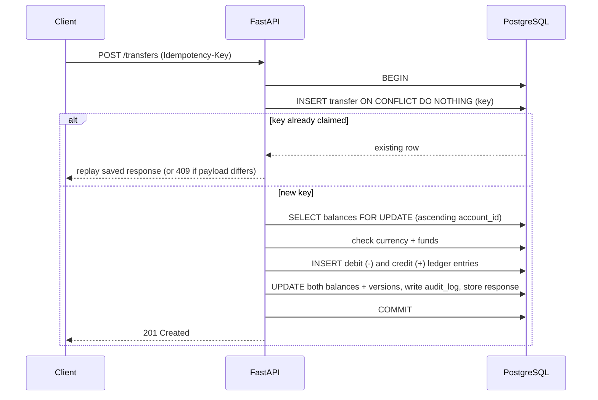
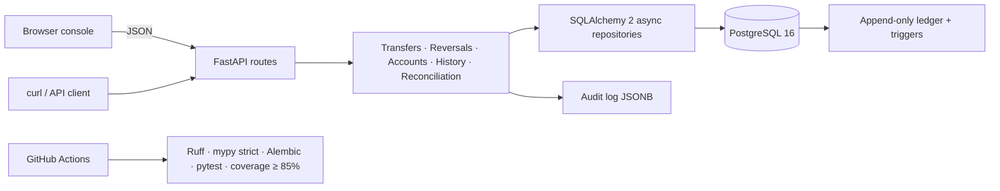

<div align="center">

# 💸 LedgerPay

**A money-transfer API where money can't be created, destroyed, double-spent or silently lost, and where you can prove it.**

Double-entry ledger · idempotent retries · deadlock-free locking · append-only history · automatic reconciliation

[](https://github.com/varunsahu258/ledgerpay/actions/workflows/ci.yml)


</div>

---

## The problem

Moving money looks trivial (`balance -= x; balance += x`) until real life shows up:

- A mobile client **retries** a timed-out request. Is the customer charged twice?
- Two transfers go **A → B** and **B → A** at the same instant. Does the database deadlock?
- Someone runs a bad `UPDATE`. Can anyone tell **where the money went**?
- A bug drifts one balance by a cent. Will you ever **notice**?

LedgerPay is a small, readable backend that answers each of those questions with a concrete mechanism and a test that proves it.

## Guarantees at a glance

| Guarantee | Mechanism | Proven by |
| --- | --- | --- |
| **No double charge on retry** | Required `Idempotency-Key`; request hash + response stored; unique constraint arbitrates concurrent duplicates | Integration + concurrency tests |
| **No deadlocks** | Balance rows are always locked in ascending account-ID order, even for opposite-direction transfers | 200-worker `asyncio.gather` run |
| **Money is conserved** | Every transfer writes a debit and an equal credit in one transaction; global ledger sum stays `0` | Hypothesis property tests |
| **History can't be rewritten** | PostgreSQL triggers reject `UPDATE`/`DELETE` on `ledger_entries` | Migration + trigger tests |
| **Mistakes are fixable, not erasable** | Reversal = new linked transfer with opposite entries, allowed once per transfer | Reversal tests |
| **Drift is detectable** | `balance == opening_balance + SUM(ledger entries)` re-checked for every account | Reconciliation CLI + corruption tests |
| **No floating-point errors** | All amounts are integer minor units (cents/paise) | Schema + validation |

### Measured result

The concurrency suite runs **200 simultaneous transfers across 10 accounts**. Latest recorded run ([`tests/results/invariants.json`](tests/results/invariants.json)):

```json
{ "transfers_attempted": 200, "succeeded": 180, "rejected": 20, "invariant_violations": 0, "run_status": "passed" }
```

Rejected transfers are legitimate business rejections (e.g. insufficient funds). Violations of money-safety invariants: **zero**.

## Quick start

Requirements: Docker Desktop, [`uv`](https://docs.astral.sh/uv/), Python 3.12.

```bash
git clone https://github.com/YOUR-USERNAME/ledgerpay.git && cd ledgerpay
uv sync --python 3.12 --all-groups
make demo      # starts PostgreSQL + API, seeds 20 accounts and 500 transfers via the real HTTP API
make site      # builds static OpenAPI docs and the concurrency report
```

| Open | What you get |
| --- | --- |
| http://localhost:8000/console/ | Browser console: create accounts, send transfers, view ledger, reverse |
| http://localhost:8000/docs | Swagger UI |
| http://localhost:8000/redoc | ReDoc |
| http://localhost:8000/health | Health check (runs `SELECT 1`) |

> 📸 **Add a screen recording of the console here** (`docs/demo.gif`), the single biggest upgrade you can make to a README.

## Try it in 60 seconds

```bash
# 1. create two accounts
curl -s -X POST localhost:8000/accounts -H 'Content-Type: application/json' \
  -d '{"owner_name":"Ada Lovelace","currency":"USD"}'

# 2. transfer 12.50 (1250 minor units), safe to retry
curl -s -X POST localhost:8000/transfers \
  -H 'Content-Type: application/json' -H 'Idempotency-Key: demo-001' \
  -d '{"from_account":1,"to_account":2,"amount_minor":1250}'

# 3. send the EXACT same request again -> same response, no second transfer
curl -s -X POST localhost:8000/transfers \
  -H 'Content-Type: application/json' -H 'Idempotency-Key: demo-001' \
  -d '{"from_account":1,"to_account":2,"amount_minor":1250}'

# 4. verify the books balance
uv run python -m app.reconcile
```

Same key with a *different* payload returns `409 idempotency_key_reused`.

## How a transfer works



Business failures (e.g. `insufficient_funds`) are stored against the key too, so a retry returns the same answer instead of re-running the logic.

## Architecture



```text
app/
  api/            HTTP routes and validation
  services/       transfer, reversal, account, history, reconciliation logic
  repositories/   database access
  models/         SQLAlchemy tables
  schemas/        Pydantic request/response models
  static/console/ same-origin browser console (no CORS, no build step)
alembic/          versioned migrations, including the append-only trigger
tests/            unit · integration · property-based · concurrency
```

## Data model

| Table | Purpose |
| --- | --- |
| `accounts` | Owner, currency, non-negative `opening_balance_minor` baseline |
| `transfers` | One operation: UUID, **unique idempotency key**, request hash, stored response, optional `reversal_of` (unique → one reversal each) |
| `ledger_entries` | Immutable signed postings (debit negative, credit positive); **update/delete blocked by trigger** |
| `balances` | Materialized current balance + version, one row per account |
| `audit_log` | Actor, action, entity, JSONB details |

The invariant reconciliation enforces:

```text
balances.balance_minor = accounts.opening_balance_minor + SUM(ledger_entries.amount_minor)
SUM(all ledger_entries.amount_minor) = 0
```

Full ER diagram: [docs/schema.md](docs/schema.md).

## API

| Method | Path | Notes |
| --- | --- | --- |
| `POST` | `/accounts` | Create zero-balance account |
| `GET` | `/accounts` | Keyset pagination (`cursor`, `limit` 1-100) with current balances |
| `GET` | `/accounts/{id}` | Account details |
| `GET` | `/accounts/{id}/transactions` | Ledger history, newest first, date filters, cursor pagination |
| `POST` | `/transfers` | Requires `Idempotency-Key` |
| `POST` | `/transfers/{uuid}/reverse` | Requires `Idempotency-Key`; one reversal per transfer |
| `GET` | `/health` | Database connectivity |

Errors always look like `{"code": "...", "message": "..."}`: `insufficient_funds`, `currency_mismatch`, `same_account`, `already_reversed`, `idempotency_key_reused`, `account_not_found`, `transfer_not_found`.

## Testing philosophy

```bash
make test   # migrates, runs the suite, enforces ≥ 85% coverage
make lint   # Ruff + format check + strict mypy
```

- **Unit and integration tests** against a real PostgreSQL (SQLite would not exercise row locks, JSONB or triggers).
- **Property-based tests (Hypothesis)** generate random sequences of transfers, retries and invalid operations, then assert no negative balances, per-account reconciliation and a zero global sum.
- **Concurrency test**: 200 workers hammer 10 accounts; invariants must hold afterwards.
- **Corruption detection**: tests tamper with balances and confirm reconciliation catches it.
- **CI** runs the same gates on every push against a PostgreSQL 16 service.

## Design decisions

Short ADRs live in [DECISIONS.md](DECISIONS.md). Highlights:

1. **PostgreSQL as source of truth**, because correctness depends on row locks, constraints and triggers.
2. **Double-entry over balance-only updates**, so every change is explainable.
3. **Integer minor units**, never floats.
4. **Idempotency key + payload hash**, so a safe retry is distinguishable from accidental key reuse.
5. **Global lock ordering**, which removes lock cycles by construction.
6. **Explicit opening balances**, so normal account creation cannot mint money.

## Deploying a public demo

Set `DEMO_MODE=true` to enable per-IP write rate limiting and an account cap. `scripts/reset_demo.py` refuses to run unless explicitly enabled. See [docs/DEPLOY.md](docs/DEPLOY.md) (Render + Neon).

## Honest limitations

This is an engineering showcase, **not** a production bank.

- No authentication/authorization, tenants, or secrets management.
- No external processor, deposits, settlement, chargebacks or currency conversion.
- Reconciliation *detects* drift; it does not auto-repair.
- Demo rate limiter is process-local.

## Roadmap

- [ ] JWT auth with per-account ownership checks
- [ ] Outbox pattern + webhooks for transfer events
- [ ] Multi-currency with FX rate snapshots
- [ ] Prometheus metrics and structured logging
- [ ] Scheduled reconciliation job with alerting

## License

MIT. See [LICENSE](LICENSE).
