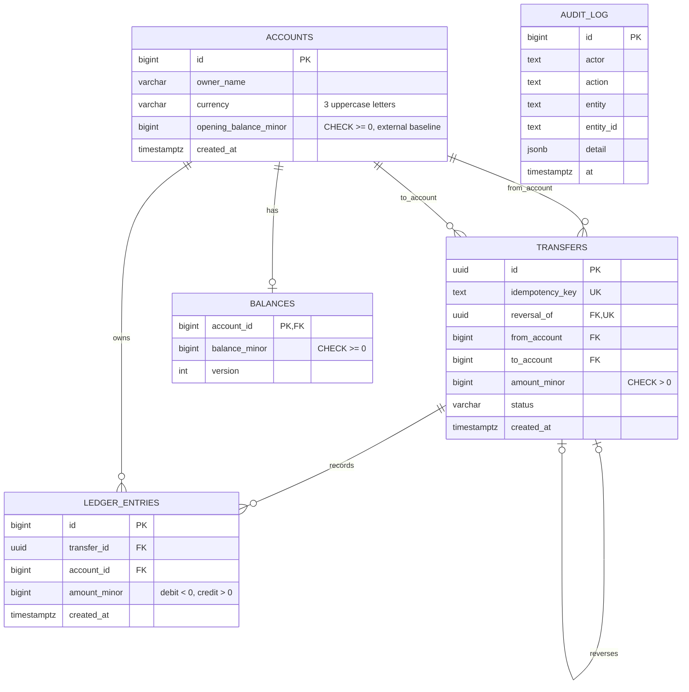

# LedgerPay schema

All monetary values are integer minor units (for example, cents). `accounts.currency` identifies
the currency for those units. A transfer links two accounts and is uniquely identified by its
idempotency key. A reversal is a new transfer with `reversal_of` pointing to the original; a
unique constraint allows at most one reversal per transfer. Each transfer can produce debit and
credit rows in `ledger_entries`; a debit is
negative and a credit is positive. Ledger rows are append-only: PostgreSQL rejects `UPDATE` and
`DELETE` through a row trigger. `balances` stores the current nonnegative balance and a version for
optimistic concurrency. `accounts.opening_balance_minor` records externally supplied starting
capital and defaults to zero; reconciliation compares `balances` with this baseline plus ledger
entries. The demo-only bootstrap updates this baseline and records an audit event. `audit_log.detail`
stores structured JSON metadata.

